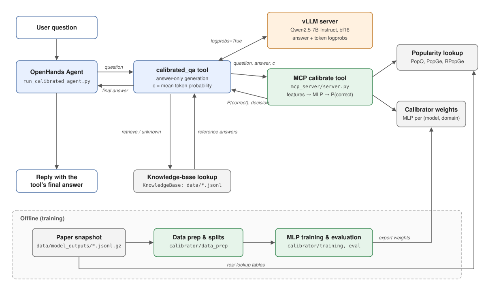

# 系统架构

## 架构图

## 组件与职责

| 组件 | 职责 |
|---|---|
| OpenHands Agent | 按 system prompt 调用 `calibrated_qa`，原样转述其返回的 final answer |
| `calibrated_qa` 工具 | answer-only 生成、由 logprobs 计算 c、调用 MCP `calibrate`、决策；retrieve / unknown 时在工具内部检索知识库 |
| vLLM 端点 | 提供模型生成与逐 token logprobs |
| MCP 校准服务 | 查流行度特征、组装特征、MLP 推理、阈值决策、降级 |
| 离线流行度表 | 提供 PopQ、PopGe、RPopGe（论文快照中的实体） |
| 校准器权重 | per (model, domain) 的 MLP |
| 知识库检索（`KnowledgeBase`） | 在论文三份源数据上做本地检索，由 `calibrated_qa` 内部调用（`search_qa` 工具已注册但不暴露给 agent） |
| 离线复现与训练 | 构造数据与特征、训练 MLP |
| 决策与评测 | 阈值标定、端到端评估（`evaluation/`） |

## 一次请求的数据流

1. 用户向 agent 提出事实问题。
2. agent 调用 `calibrated_qa`，工具向 vLLM 发起 answer-only 生成，请求带 `logprobs=True`。
3. 工具取 answer 与逐 token logprobs，计算 c = mean(exp(logprob_i))（排除特殊停止 token）。
4. 工具经 stdio MCP 调用 `calibrate(question, answer, c, model, domain)`。
5. MCP 按问题模板解析实体，查离线流行度表补齐 PopQ、PopGe、RPopGe；查不到的特征按论文口径填 0。
6. MCP 组装特征向量，按 model 与 domain 选权重，MLP 输出 P(正确)。
7. MCP 与 P2 导出的阈值比较，给出 answer 或 retrieve；缺权重、歧义实体等情况返回 unknown。
8. 决策为 answer 时，工具把生成的答案作为 final answer 返回；retrieve / unknown 时，工具内部用
   `KnowledgeBase` 检索本地知识库，把检索到的标准答案作为 final answer 返回。
9. agent 原样转述工具返回的 final answer。

## logprobs 通道

校准器的第一输入特征 c 必须由 logprobs 计算得到。`calibrated_qa` 在工具内部用 OpenAI 兼容
客户端直接请求 vLLM（`logprobs=True`），在同一次调用中拿到答案与逐 token logprobs 并算出 c，
不经过 agent 主 LLM 的 completion，因此无需 patch OpenHands。
