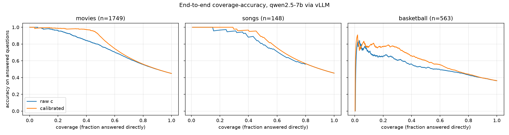

# 端到端评测与工程化技术文档（P5）

本文描述 P5 的工作：校准器接入 agent 后的端到端消融评测（设计、实现、结果、局限），
一键复现与 CI 门禁，以及 TC2 上的复现结果。英文完整报告见
[evaluation/README.md](../evaluation/README.md)，复现原始输出见
[scripts/README.md](../scripts/README.md) 与 [reproduce_output/](../reproduce_output/)。

## 1. 评测目标与范围

问题：把校准器插进 agent 后，agent 是否答得更准、少拒答、少检索？

只测 `evaluation/README.md` 与 [03-development-guide.md](03-development-guide.md) M5 要求的指标：
准确率、拒答率、检索率、覆盖率–准确率曲线，对比校准器开/关 × 检索兜底开/关。
[05 号文档](05-agent-tools-technical-doc.md) §6.1 中的特征子集（c-only、c+RPopGe）与模型精度
（bf16 vs AWQ）两项消融不在 M5 验收要求内，未做。

## 2. 评测设计

### 2.1 题库

部署模型 `qwen2.5-7b` 的 P2 balanced 测试集（`load_split(..., protocol="balanced").meta_test`），
校准器训练时没见过这些题：

| 数据集 | 题数 |
|---|---|
| Movies | 1,749 |
| Songs | 148 |
| Basketball | 563 |
| 合计 | 2,460 |

### 2.2 两个开关、四种配置

每道题只生成一次。两个开关都不改变生成的答案，只改变"答还是不答"和"不答之后怎么办"，
所以四种配置都由同一批生成记录推出，保证对比只差开关本身。

| 开关 | 取值 | 行为 |
|---|---|---|
| 决策源 | raw（校准器关） | c ≥ P2 的 Prob 基线阈值则直接回答（movies 0.8222，songs 0.8636，basketball 0.8185） |
| | calibrated（校准器开） | 校准概率 P(正确) ≥ artifact 阈值则直接回答；`unknown` 视为不答 |
| 检索兜底 | off | 不答 = 拒答，计为错 |
| | on | 不答 → 查本地知识库（`KnowledgeBase`），用检索到的标准答案作答 |

raw 的阈值取 P2 Prob 基线的阈值，它和校准器阈值用同样的方法在训练半区上标定，
因此两者的比较是公平的。

### 2.3 指标定义

- **准确率**：答对题数 / 全部题数（分母含拒答与检索的题）。
- **拒答率**：检索关时，不直接回答的比例。
- **检索率**：检索开时，转去知识库检索的比例。拒答率与检索率由同一批"不答"决定，
  数值相同，分别只在检索关/开时有意义。
- **覆盖率–准确率曲线**（Kamath et al., 2020, §3.1）：按分数（raw c 或校准概率）从高到低
  排序，只回答前 k 题，覆盖率 = k / n，准确率 = 这 k 题里答对的比例。曲线只依赖决策源，
  不依赖检索开关。
- **正确性判定**：论文的 `has_answer` 规则（NFD 规范化、小写、标点变空格、去冠词、
  按 Unicode 词切分后做连续子序列匹配）。在全部 26,430 条论文存档标签上与论文结果一致
  （见 `evaluation/tests/test_run_ablation.py`）。

## 3. 实现

### 3.1 文件

| 文件 | 作用 |
|---|---|
| [evaluation/run_ablation.py](../evaluation/run_ablation.py) | 生成、校准、四种配置的指标、报告与曲线 |
| [evaluation/run_ablation.slurm](../evaluation/run_ablation.slurm) | TC2 一键作业：起 vLLM → 跑消融 → 关 vLLM |
| [evaluation/coverage_accuracy.py](../evaluation/coverage_accuracy.py) | 论文快照上的离线覆盖率–准确率曲线（不需要 vLLM） |
| `evaluation/tests/` | 正确性规则、指标算术、快照 dry run |

### 3.2 数据流

```text
P2 测试集题目
  → generate_answer（P4，vLLM answer-only，logprobs=True）→ answer + c
  → CalibrationService.calibrate（P3，即 MCP calibrate 工具背后的代码）→ P(正确)、阈值、status
  → has_answer(reference, answer)                     → correct_closed
  → KnowledgeBase.search（P4，calibrated_qa 低置信时内部调用的检索）→ correct_retrieved
  → 每题一条记录写入 evaluation/output/ablation_records.jsonl
  → decide(mode) × retrieval → 四种配置的准确率 / 拒答率 / 检索率 + 曲线
```

评测直接调用 P3、P4 工具背后的 Python 函数，不经过 stdio MCP 子进程，也不经过 OpenHands
主 LLM 的编排。所以测到的是"生成 → 校准 → 决策 → 检索"这条决策链本身。这条链与部署后的
`calibrated_qa` 一致：PR #3 起，`calibrated_qa` 在决策为 retrieve / unknown 时在工具内部
调用 `KnowledgeBase` 并返回标准答案作为 final answer，agent 只原样转述。因此检索开时，
把检索到的标准答案别名当作 agent 的回答来判分，与线上行为相同。

### 3.3 关键函数

- `decide(rec, mode, raw_threshold)`：调用 P4 的 `DecisionPolicy.decide`；生成失败的题返回 `unknown`。
- `config_metrics(recs, mode, retrieval, raw_threshold)`：直接回答的题按 `correct_closed` 计分；
  不答的题在检索开时按 `correct_retrieved` 计分，检索关时计 0。
- `coverage_accuracy(y, score)`：稳定排序后累加命中数，`hits / k`；校准器给不出分数的题排在最后。
- `--metrics-only`：不连 GPU，从已保存的记录重算全部指标。

## 4. 结果

环境：`Qwen/Qwen2.5-7B-Instruct`，bf16，vLLM 0.17.0，贪心解码；TC2 单卡 A40；生成错误 0 条。

### 4.1 四种配置

| 数据集 | 决策源 | 检索关：准确率 | 检索关：拒答率 | 检索开：准确率 | 检索开：检索率 |
|---|---|---|---|---|---|
| Movies（1,749） | raw | 0.354 | 0.572 | 0.926 | 0.572 |
| | calibrated | **0.434** | **0.544** | **0.978** | **0.544** |
| Songs（148） | raw | 0.351 | 0.622 | 0.973 | 0.622 |
| | calibrated | **0.392** | **0.588** | **0.980** | **0.588** |
| Basketball（563） | raw | 0.181 | 0.702 | 0.883 | 0.702 |
| | calibrated | **0.242** | **0.661** | **0.902** | **0.661** |

三个数据集上，开校准器都在提高准确率的同时降低了拒答率和检索率。所以增益不是靠
"多拒答、多检索"换来的，而是因为挑得更准：c 高但答错的题被拦下，c 偏低但答对的题被放行。
这满足 M5 验收标准"校准后准确率或覆盖-准确率曲线上有可量化的正向收益"。

### 4.2 端到端覆盖率–准确率曲线



| 数据集 | 分数 | cov 0.2 | cov 0.4 | cov 0.6 | cov 0.8 | cov 1.0 |
|---|---|---|---|---|---|---|
| Movies | raw c | 0.963 | 0.841 | 0.703 | 0.555 | 0.449 |
| | calibrated | **0.986** | **0.973** | **0.745** | **0.559** | 0.449 |
| Songs | raw c | 0.967 | 0.883 | 0.708 | 0.563 | 0.453 |
| | calibrated | **1.000** | **0.950** | **0.753** | 0.563 | 0.453 |
| Basketball | raw c | 0.655 | 0.558 | 0.494 | 0.430 | 0.362 |
| | calibrated | **0.770** | **0.659** | **0.553** | **0.441** | 0.362 |

在列出的覆盖率上，校准曲线都不低于 raw 曲线。覆盖率 1.0 时所有题都直接回答，两者都等于
闭卷准确率。

离线曲线（`coverage_accuracy.py`，用论文快照里的存档答案，不经过 vLLM）的趋势相同，
例如 cov 0.4 时 movies 0.859 → 0.976、basketball 0.619 → 0.770，见
[coverage_accuracy_qwen2.5-7b.md](../evaluation/output/coverage_accuracy_qwen2.5-7b.md)。

### 4.3 流行度特征覆盖

| 数据集 | 特征全部命中（ok） | 部分缺失、按论文口径填 0 | 实体噪声（unknown） |
|---|---|---|---|
| Movies | 1,032 | 717（41%） | 0 |
| Songs | 81 | 60（41%） | 7 |
| Basketball | 368 | 195（35%） | 0 |

离线流行度表只覆盖论文快照里出现过的答案，vLLM 新生成的答案很多不在表里，约 40% 的题
在特征填 0 的情况下校准。上面的增益是在这种情况下取得的。

## 5. 局限（写报告时必须保留）

- **检索开时的准确率是理想检索上限。** 知识库检索在 `data/*.jsonl` 里按问题查出标准答案，
  被检索的题几乎必然答对。0.9 以上的准确率反映的是理想检索，不能写成 RAG 系统的效果。
- **闭卷准确率低于 0.5。** balanced 测试集按存档答案是一半对一半错，但 vLLM 重新生成的答案
  正确率只有 44.9%（movies）、45.3%（songs）、36.2%（basketball），说明部署时的答案与论文
  存档答案不完全相同。
- **Songs 样本小。** 148 题里 1 题 = 0.007；检索开时 0.973 vs 0.980 只差 1 题。
- **评测不经过 agent 主 LLM**（见 §3.2）。主 LLM 是否原样转述工具的 final answer 由 demo 覆盖。
- **单次运行，没有置信区间。**
- **agent 改写问题会让校准与检索都失准。** 主 LLM 调用 `calibrated_qa` 时偶尔会改写问题
  （两次 demo 各 1/10，都是第 5 题）。改写后有两个后果：
  1. 流行度查找按问题模板前缀切出实体，前缀或实体被改动后查不到 PopQ 与 RPopGe，按论文口径
     填 0，校准概率偏低，倾向触发检索。
  2. 改写可能丢掉实体里的消歧信息，检索会命中别的条目。第二次 demo 中，"Who is the performer
     of the song Rainmaker (Emmelie de Forest song)" 被改写成 "…the song Rainmaker?"，
     `KnowledgeBase` 的兜底匹配（取问题中出现的最长实体，不检查词边界）命中了另一首歌
     "Rain"，返回 Yui，agent 最终答错（标准答案 Emmelie de Forest）。
  第一次 demo 中同一题被改写成 "Rainmaker (Emmelie de Forest song) performer"，消歧信息还在，
  检索后答对。端到端评测直接传入数据集原题，不受影响。

## 6. 一键复现与 CI 门禁

### 6.1 一键复现

[scripts/reproduce.sh](../scripts/reproduce.sh)，Linux / TC2，Python ≥ 3.12：

```bash
bash scripts/reproduce.sh test   # 建 .venv-eval、拉论文仓库（commit 1b1f250）并生成 res/、跑全部 CPU 测试
bash scripts/reproduce.sh        # 再复现 P1 论文统计、P2 校准器评测与 18 套权重、离线曲线
bash scripts/reproduce.sh gpu    # TC2 登录节点：建 .venv1（vLLM）并提交端到端消融作业
```

依赖版本全部锁定在 [scripts/requirements.txt](../scripts/requirements.txt)（CPU 环境）与
`model_runtime/vllm/requirements.txt`（vLLM 0.17.0 + torch 2.10.0+cu128；TC2 驱动只支持 CUDA 12.8）。

### 6.2 CI 门禁

[.github/workflows/ci.yml](../.github/workflows/ci.yml)：每次 push / PR 在 GitHub Actions
（ubuntu-latest，Python 3.12）上运行 `bash scripts/reproduce.sh test`，覆盖 `calibrator`、
`mcp_server`、`evaluation` 三个目录的测试，已通过（65 passed）。要让 CI 失败时禁止合并，
需要仓库管理员在 main 上开启 branch protection。

### 6.3 TC2 复现结果（2026-11-13）

详见 [scripts/README.md](../scripts/README.md)「TC2 复现结果」，原始输出在
[reproduce_output/](../reproduce_output/)：

| 部分 | 结果 |
|---|---|
| P1 论文统计 + bootstrap | 与 [P1 报告](../calibrator/P1_REPRODUCTION_REPORT.md) 一致 |
| P2 评测报告 | 非 MLP 基线完全一致；MLP 行有 3 处相差 0.001 |
| P2 重新训练的 18 套权重 | 权重数值不是逐位相同；测试集 Alignment 14 套相同，4 套（均为 movies）各差 1 题 |
| 部署用 qwen2.5-7b 三套 | Alignment / AUROC / Brier 相同；阈值差 < 0.001；basketball ECE 0.053 → 0.050 |
| `gpu` 档自动建 `.venv1` | 未从零测试（`.venv1` 手动建好，消融作业已用它跑通） |

差异来源未核实，最可能是 P2 训练时的 torch 版本没有记录，CPU 上 MLP 训练的浮点细节随版本变化。

## 7. 端到端 demo

[scripts/demo.sh](../scripts/demo.sh)：在 TC2 GPU 节点起 bf16 vLLM（带工具调用参数），运行
P4 的 `run_calibrated_agent.py`，依次问 [scripts/demo_questions.txt](../scripts/demo_questions.txt)
中的 10 道 P2 测试题（三个领域，含"自信但答错、被校准器拦下"与"c 偏低但答对、被校准器放行"
的题），每题一个新会话。

```bash
srun --partition=MGPU-TC2 --gres=gpu:1 --cpus-per-task=8 --mem=32G --time=01:00:00 --pty bash -l
bash -l scripts/demo.sh
```

共录了两次，录屏与完整终端日志都保留在仓库里：

| 版本 | 时间 | 代码 | 录屏与日志 |
|---|---|---|---|
| v1 | 2026-11-14 00:43 | PR #3 之前 | [evaluation/demo/v1-before-pr3/](../evaluation/demo/v1-before-pr3/) |
| v2（最终） | 2026-11-14 02:06 | PR #3 之后 | [evaluation/demo/demo.mp4](../evaluation/demo/demo.mp4)、[demo_log.txt](../evaluation/demo/demo_log.txt) |

#### v1：暴露两个问题，均已在 PR #3 修复

1. 主 LLM 调用工具时常在问题末尾加 "?"（10 题中 6 题），流行度查找因此切不出实体，PopQ 与
   RPopGe 被填 0，校准概率大幅偏低（例如 Avengers: Age of Ultron 从 0.995 降到 0.094）。
   修复后带不带 "?" 结果相同。
2. 决策为 retrieve 时，主 LLM 有 2/7 次没有调用 `search_qa`，却声称答案已检索核实（其中
   Lee Mi-sun 一题因此答错）。修复后检索移入 `calibrated_qa` 内部，agent 只转述 final answer。

v1 最终答对 9/10，但其中 Avengers 一题未经检索、Mission: Impossible 一题是 "?" bug 让校准
概率偏低才触发了检索，碰巧纠正。

#### v2：修复后，最终答对 8/10

| # | 问题（实体） | 模型答案 | c | 校准概率 | 决策 | 最终回答 | 对错 |
|---|---|---|---|---|---|---|---|
| 1 | Avengers: Age of Ultron | Joss Whedon | 0.9997 | 0.9947 | answer | Joss Whedon | ✅ |
| 2 | The Death of Ivan the Terrible | Sergei Eisenstein | 0.9930 | 0.0379 | retrieve | Vasily Goncharov | ✅ |
| 3 | The Dreamers | Bernardo Bertolucci | 0.8319 | 0.9447 | answer | Bernardo Bertolucci | ✅ |
| 4 | Mission: Impossible | Christopher McQuarrie | 0.9835 | 0.9908 | answer | Christopher McQuarrie | ❌ |
| 5 | Rainmaker (Emmelie de Forest song) | Lenny Kravitz | 0.7327 | 0.0550 | retrieve | Yui | ❌ |
| 6 | These Dreams | Norah Jones | 0.8021 | 0.0637 | retrieve | Heart | ✅ |
| 7 | Shook Ones | Mobb Deep | 0.8399 | 0.8831 | answer | Mobb Deep | ✅ |
| 8 | Jakob Pöltl | Vienna | 0.9937 | 0.8153 | answer | Vienna | ✅ |
| 9 | Lee Mi-sun | South Korea | 0.9815 | 0.3019 | retrieve | Gwangju | ✅ |
| 10 | Kartal Özmızrak | Istanbul | 0.8154 | 0.8324 | answer | Istanbul | ✅ |

- 两个修复都生效：第 1、3、4、6 题 agent 仍在问题末尾加了 "?"，但特征完整；4 次 retrieve
  都由工具内部检索，agent 每次都转述了工具给的 final answer。
- 校准器的作用：第 2、6、9 题 c 在 0.80–0.99 之间但答错，被拦下并经检索纠正；第 7、10 题
  c 低于 raw 阈值（songs 0.8636、basketball 0.8185）但答对，被直接放行。
- 第 4 题是校准器失误：c = 0.98、校准概率 0.99，但答案错误，直接被放行。
- 第 5 题是 agent 改写问题导致的错误，见 §5"agent 改写问题会让校准与检索都失准"。

## 8. 文档整理

- 架构图改为英文 SVG：[docs/architecture.svg](architecture.svg)，嵌入 [02-architecture.md](02-architecture.md)，
  组件表与数据流按实际实现更新。
- 根 README 增加"端到端评测（P5）""复现""文档"三节；01、03 号文档按实际实现修正
  （流行度缺失按论文口径填 0、单一阈值在训练半区标定；M0 步骤指向 `reproduce.sh test`）。
