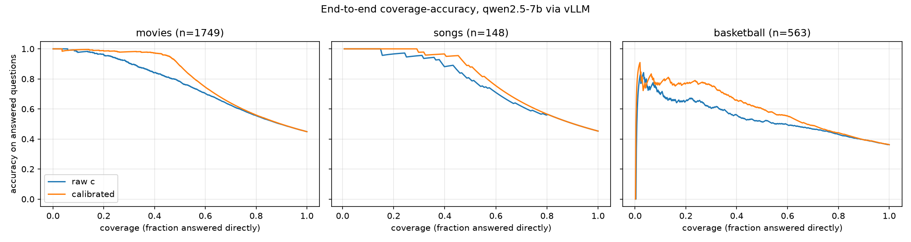

# evaluation: end-to-end evaluation report

Owner: P5.

Does the calibrator improve the agent once it is plugged in? We compare the
calibrator on and off, with retrieval on and off, using the metrics required by
this directory: accuracy, refusal rate, retrieval rate, and the
coverage-accuracy curve.

## Setup

| Item | Value |
|---|---|
| Model | `Qwen/Qwen2.5-7B-Instruct`, bf16, vLLM 0.17.0, greedy decoding (`model_runtime/vllm/start_qwen25_7b.sh`) |
| Hardware | TC2, 1 GPU, Slurm job `evaluation/run_ablation.slurm` |
| Questions | P2 balanced test split: movies 1,749, songs 148, basketball 563 (2,460 total). The calibrator never saw these questions. |
| Generation | P4 `generate_answer` (answer-only prompt, `logprobs=True`); c = mean token probability |
| Calibration | P3 `CalibrationService` (the code behind the MCP `calibrate` tool), MLP(full) artifacts from P2 |
| Correctness | the paper's normalized containment rule (`has_answer`); matches all 26,430 archived labels |
| Generation errors | 0 |

Each question is generated once. All four configurations are derived from the
same generation, because neither switch changes the generated answer:

| Switch | Value | Behaviour |
|---|---|---|
| Decision source | raw (calibrator off) | answer iff c >= P2's Prob threshold (movies 0.8222, songs 0.8636, basketball 0.8185) |
| | calibrated (calibrator on) | answer iff P(correct) >= the artifact threshold; `unknown` counts as a non-answer |
| Retrieval | off | a non-answer is a refusal and counts as wrong |
| | on | a non-answer goes to the knowledge-base lookup (`KnowledgeBase`, which `calibrated_qa` calls internally), and its reference answers become the final answer |

Refusal rate exists only with retrieval off and retrieval rate only with
retrieval on; the curve depends only on the decision source.

## Results

Accuracy is computed over all questions in the dataset.

| Dataset | Decision | Retrieval off: accuracy | Retrieval off: refusal rate | Retrieval on: accuracy | Retrieval on: retrieval rate |
|---|---|---|---|---|---|
| Movies (1,749) | raw | 0.354 | 0.572 | 0.926 | 0.572 |
| | calibrated | **0.434** | **0.544** | **0.978** | **0.544** |
| Songs (148) | raw | 0.351 | 0.622 | 0.973 | 0.622 |
| | calibrated | **0.392** | **0.588** | **0.980** | **0.588** |
| Basketball (563) | raw | 0.181 | 0.702 | 0.883 | 0.702 |
| | calibrated | **0.242** | **0.661** | **0.902** | **0.661** |

On every dataset the calibrator raises accuracy and at the same time lowers the
refusal and retrieval rates, so the gain does not come from refusing or
retrieving more. It comes from better selection: overconfident wrong answers
(high c) are sent away, and correct answers with lower c are answered directly.

### Coverage-accuracy

Coverage is the fraction of questions answered directly (highest score first);
accuracy is measured on those answered questions.



| Dataset | Score | cov 0.2 | cov 0.4 | cov 0.6 | cov 0.8 | cov 1.0 |
|---|---|---|---|---|---|---|
| Movies | raw c | 0.963 | 0.841 | 0.703 | 0.555 | 0.449 |
| | calibrated | **0.986** | **0.973** | **0.745** | **0.559** | 0.449 |
| Songs | raw c | 0.967 | 0.883 | 0.708 | 0.563 | 0.453 |
| | calibrated | **1.000** | **0.950** | **0.753** | 0.563 | 0.453 |
| Basketball | raw c | 0.655 | 0.558 | 0.494 | 0.430 | 0.362 |
| | calibrated | **0.770** | **0.659** | **0.553** | **0.441** | 0.362 |

The calibrated curve is never below the raw curve at the reported coverages.
At coverage 1.0 every question is answered, so both scores give the plain
closed-book accuracy.

### Popularity-feature coverage

| Dataset | All features found (`ok`) | Some features missing, zero-filled | Noisy entity (`unknown`) |
|---|---|---|---|
| Movies | 1,032 | 717 (41%) | 0 |
| Songs | 81 | 60 (41%) | 7 |
| Basketball | 368 | 195 (35%) | 0 |

The offline popularity table only covers answers that appear in the paper's
snapshot (see `calibrator/README.md`). Many freshly generated answers are not
in it, so about 40% of the questions are calibrated with zero-filled features,
following the paper's protocol. The gains above are obtained despite this.

## Caveats

- **Retrieval-on accuracy is an upper bound.** The knowledge-base lookup finds the question
  in `data/*.jsonl` and returns its reference answers, so a retrieved question
  is almost always correct. The retrieval-on accuracy reflects ideal retrieval
  and must not be reported as the effect of a RAG system.
- **Closed-book accuracy is below 0.5.** The balanced split is 50% correct for
  the archived answers, but the vLLM answers are correct 44.9% (movies), 45.3%
  (songs) and 36.2% (basketball) of the time, so the deployed answers differ
  from the archived ones.
- **Songs is small.** With 148 questions one question is 0.007; the
  retrieval-on difference (0.973 vs 0.980) is a single question.

## Reproduce

From the repository root on a TC2 login node (`module load python312` first):

```bash
bash scripts/reproduce.sh gpu
```

This creates `.venv-eval` (`scripts/requirements.txt`) and `.venv1`
(`model_runtime/vllm/requirements.txt`, CUDA 12.8 wheels), fetches
`reference/Popular-but-Wrong` at commit `1b1f250` with `res/` materialized, and
submits `evaluation/run_ablation.slurm`.

Outputs in `evaluation/output/`: `ablation_metrics.md` / `.json` (tables),
`ablation_curves.png`, `ablation_records.jsonl` (one record per question). To
recompute the tables from saved records without a GPU:
`python -m evaluation.run_ablation --metrics-only`.

The offline curves on the archived snapshot (no vLLM) are produced by
`python -m evaluation.coverage_accuracy`.

| File | Purpose |
|---|---|
| `run_ablation.py` | generation, calibration, the four configurations, report |
| `run_ablation.slurm` | one-command TC2 job: start vLLM, run the ablation, stop vLLM |
| `coverage_accuracy.py` | offline coverage-accuracy curves on the archived snapshot |
| `tests/` | correctness rule, metric arithmetic, snapshot dry run (`pytest evaluation`) |
